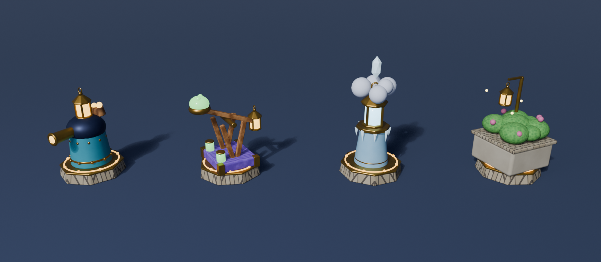
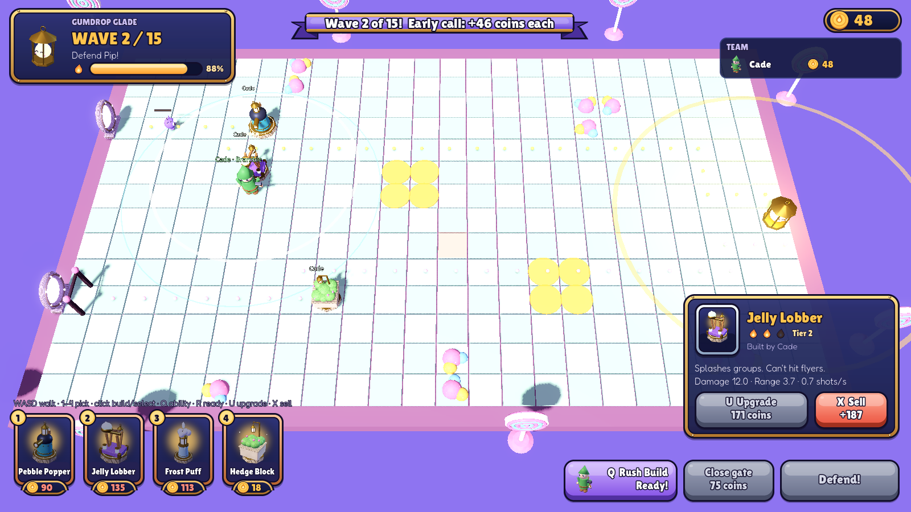
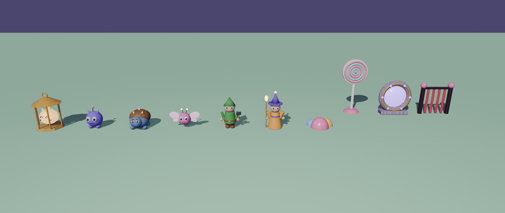
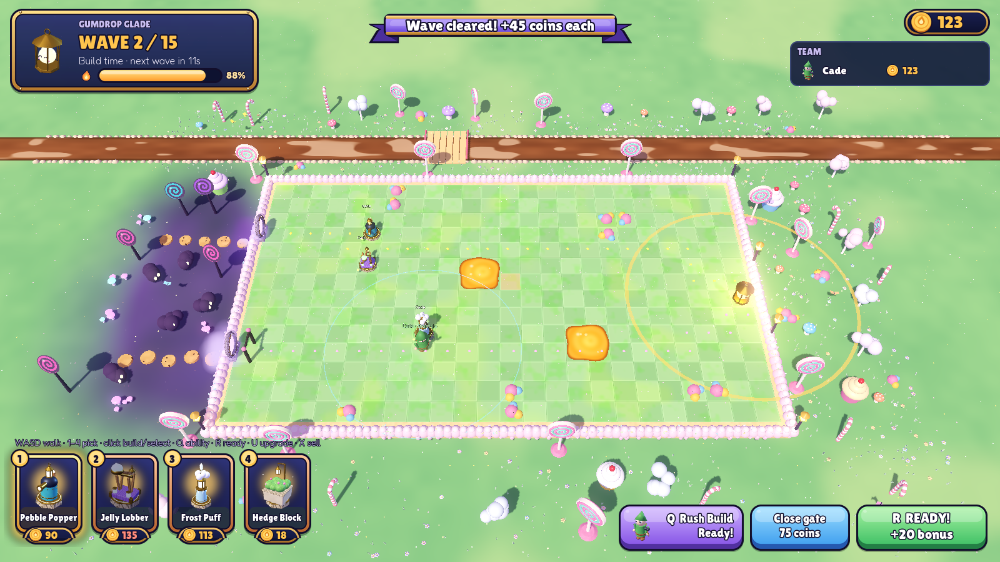

# Lanternfall

A colorful co-op tower-defense game for family and friends. Build a maze of lantern-guardian towers and keep **Pip**, a sleepy living lantern, glowing against waves of mischievous **Snuffers**.

Built with **Godot 4.7** (GDScript) for Windows and macOS, with a dedicated server that runs in Docker.



## Status: Phase 1 (first playable)





**Gumdrop Glade**, 15 surprise waves and a boss, for 1–8 players:

- **Towers that fight:** Pebble Popper (fast shots, hits flyers), Jelly Lobber (splash, ground only), Frost Puff (slows everything nearby), Hedge Block (cheap wall). Upgrade to tier 3, sell for 80% back.
- **Snuffers:** Scamper (fast), Shellback (armored), Flutter (flies over your maze). Wave 16 is the **Big Shellback**, who sheds little Shellbacks as its shell cracks.
- **Heroes:** **Bramble** (towers cost 10% less; *Rush Build* makes the next 3 towers 25% cheaper) and **Glint** (nearby towers fire 10% faster; *Overcharge* doubles one tower's fire rate for 8 s). Walk with WASD; you can only build within reach of your hero.
- **Pip's glow:** towers inside the glow fire 10% faster. Every Snuffer that reaches Pip shrinks the glow.
- **Teamwork:** towers owned by *different* players combo when they touch (Slushy, Ice Pebbles, Hedge Watch). Gift coins to teammates (up to half your coins per wave).
- **Ready up:** when everyone's ready the wave starts early and everyone gets a coin bonus.
- **The licorice gate:** close the lower entrance for 2 waves (75 coins).
- **Gumdrop Glade:** two entrances, syrup pools that slow Snuffers, gumdrop rocks. The board is a frosted cake in a candy meadow, with a chocolate river, cookie stepping stones, cupcakes and lantern posts.



### Controls

| Key | Does |
| --- | --- |
| WASD / arrows | Walk your hero |
| 1–4 | Pick a tower |
| Left-click | Build (empty tile) or select (tower) |
| U / X | Upgrade / sell the selected tower |
| Q | Hero ability |
| R | Ready for the next wave |
| Right-click / Esc | Deselect |

## Play it from the editor

1. Open the project in Godot 4.7.
2. Press **Run** (F5).
3. Type a name and a 4–6 digit PIN, pick a hero, then click **Host & play on this computer**.
4. Walk near where you want to build, pick a tower with **1–4** and click to place it. Press **R** when you're ready.

To test with a second player on your network, have them enter your computer's IP address and click **Join game** (UDP port 7777 must be allowed through the firewall).

## Run the dedicated server (VPS)

On a Linux server with Docker installed:

```bash
git clone https://github.com/thefamilyhub-online/lanterfall.git
cd lanterfall
docker compose -f server/docker-compose.yml up -d --build
docker logs -f lanternfall-server     # should say "listening on UDP 7777"
```

Then open **UDP 7777** in the VPS firewall. Players join with the server's address.

- Accounts and progress are stored in the `lanternfall-data` Docker volume and survive rebuilds.
- To update: `git pull && docker compose -f server/docker-compose.yml up -d --build`.
- Clients and server must run the same game version; the login screen says so if they don't.

## Project layout

| Path | What's there |
| --- | --- |
| `scenes/main.tscn` | Start screen (entry scene) |
| `scripts/net.gd` | Networking: host, join, logins, player list (autoload `Net`) |
| `scripts/accounts.gd` | Server-side accounts and saved progress (autoload `Accounts`) |
| `scripts/data.gd` | All the numbers: towers, Snuffers, waves, heroes, combos, the map |
| `scripts/world.gd` | The match: waves, combat, coins, heroes, combos, gate (server-side) |
| `scripts/board_view.gd` | Everything you see on the board |
| `scripts/glade_decor.gd` | Gumdrop Glade scenery: grass tiles, cake edge, syrup, meadow, river, props |
| `scripts/hud.gd` | In-game HUD and results screen |
| `scripts/audio.gd` | Music and sound effects (autoload `Sfx`), volume sliders |
| `scripts/ui_theme.gd` | The Lanternfall look: buttons, panels, ribbon, fonts |
| `scripts/card_button.gd` | Lantern-glow cards for tower and hero picks |
| `assets/` | Models used by the game (textures baked in) |
| `art/` | Blender source files, renders, `art/tools/lanternfall_models.py`, `art/tools/make_ui.py` (draws the UI pieces) and `art/tools/make_audio.py` (synthesizes all music and sounds) — ignored by Godot |
| `server/` | Dockerfile and compose file for the dedicated server |

## Credits

Design and code: the Lanternfall family team. UI layout ideas loosely inspired by community game-UI kits; all UI art is drawn by `art/tools/make_ui.py`.

Music and sound effects: synthesized from scratch by `art/tools/make_audio.py` (original, no third-party audio).

Fonts: [Lilita One](https://fonts.google.com/specimen/Lilita+One) and [Fredoka](https://fonts.google.com/specimen/Fredoka), both under the SIL Open Font License (see `assets/fonts/`). Some future assets may come from the KayKit collections by Kay Lousberg (CC0).
