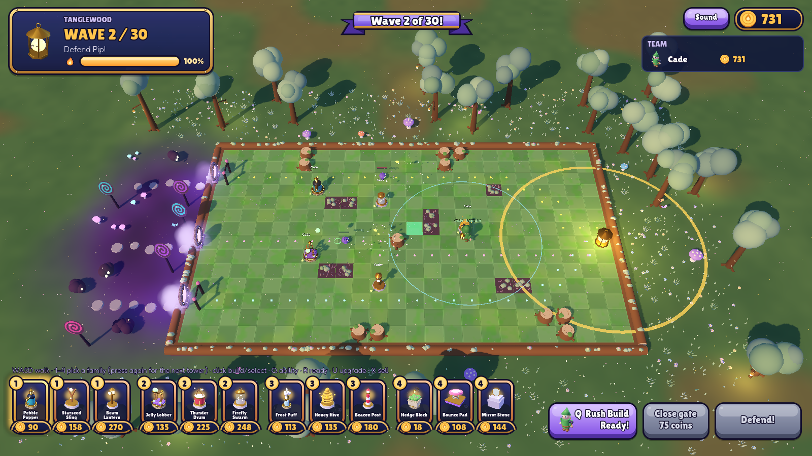

# Lanternfall

A colorful co-op tower-defense game for family and friends. Build a maze of lantern-guardian towers and keep **Pip**, a sleepy living lantern, glowing against waves of mischievous **Snuffers**.

Built with **Godot 4.7** (GDScript) for Windows and macOS, with a dedicated server that runs in Docker.


## Status: Phase 2 (more towers and waves)


Two maps, **Gumdrop Glade** and **Tanglewood**, each with 30 surprise waves, mini-bosses and a final boss, for 1–8 players:

- **12 towers in four families** (press **1–4** to pick a family, press again for the next tower in it):
  - *Shooters:* Pebble Popper (fast shots), Starseed Sling (long-range seeds that pierce), Beam Lantern (a beam that heats up on one target, great vs. bosses)
  - *Splash:* Jelly Lobber (splash), Thunder Drum (booms all around), Firefly Swarm (several targets, flyers and Shades first)
  - *Slow & support:* Frost Puff (chills nearby), Honey Hive (sticky slow; stops Menders healing), Beacon Post (boosts nearby towers' range, reveals Shades)
  - *Walls:* Hedge Block (cheap wall), Bounce Pad (springs Snuffers back along the path), Mirror Stone (touching towers deal more damage)
  - Upgrade to tier 3, sell for 80% back.
- **Snuffers:** Scamper (fast), Shellback (armored), Flutter (flies over your maze), Splitblob (pops into Bloblings), Shade (invisible until revealed by Pip's glow, a Beacon Post or fireflies), Mender (heals friends), Bubbleguard (shields friends), Jammer (jams towers it walks past).
- **Bosses:** Big Splitblob (waves 5 and 25), Big Shellback (10 and 20), Big Bubbleguard (15), and the **Sugar Snuffer** on wave 30, who calls for help and gets angrier as she cracks.
- **Heroes:** **Bramble** (towers cost 10% less; *Rush Build* makes the next 3 towers 25% cheaper) and **Glint** (nearby towers fire 10% faster; *Overcharge* doubles one tower's fire rate for 8 s). Walk with WASD; you can only build within reach of your hero.
- **Pip's glow:** towers inside the glow fire 10% faster, and Shades inside it are revealed. Every Snuffer that reaches Pip shrinks the glow.
- **Teamwork combos** (towers owned by *different* players, touching): Slushy, Ice Pebbles, Hedge Watch, Prism Path, Honey Bomb, Spring Shot, Spotlight, Glowbug Trail. Gift coins to teammates (up to half your coins per wave).
- **Ready up:** when everyone's ready the wave starts early and everyone gets a coin bonus.
- **The licorice gate:** close the lower entrance for 2 waves (75 coins).
- **Gumdrop Glade:** two entrances, syrup pools that slow Snuffers, gumdrop rocks. The board is a frosted cake in a candy meadow, with a chocolate river, cookie stepping stones, cupcakes and lantern posts, and a spooky Snuffer Hollow by the entrances.
- **Tanglewood:** a lantern-lit forest at dusk with three entrances (two with vine gates), mossy stumps and thorn patches that scratch Snuffers walking through. Its final boss is the **Vine Puffer**.
- **Music and sound** with volume sliders.




### Controls

| Key | Does |
| --- | --- |
| WASD / arrows | Walk your hero |
| 1–4 | Pick a tower family (press again for the next tower in it) |
| Left-click | Build (empty tile) or select (tower) |
| U / X | Upgrade / sell the selected tower |
| Q | Hero ability |
| R | Ready for the next wave |
| Right-click / Esc | Deselect |

## Play it from the editor

1. Open the project in Godot 4.7.
2. Press **Run** (F5).
3. Type a name and a 4–6 digit PIN, pick a hero and a map, then click **Host & play on this computer**.
4. Walk near where you want to build, pick a tower with **1–4** (or click its card) and click to place it. Press **R** when you're ready.

To test with a second player on your network, have them enter your computer's IP address and click **Join game** (UDP port 7777 must be allowed through the firewall).

## Run the dedicated server (VPS)

On a Linux server with Docker installed:

```bash
git clone https://github.com/thefamilyhub-online/lanterfall.git
cd lanterfall
docker compose -f server/docker-compose.yml up -d --build
docker logs -f lanternfall-server     # should say "listening on UDP 7777"
```

Then open **UDP 7777** in the VPS firewall. Players join with the server's address.

- Pick the map with `LANTERNFALL_MAP` in `server/docker-compose.yml` (`gumdrop_glade` or `tanglewood`).
- Accounts and progress are stored in the `lanternfall-data` Docker volume and survive rebuilds.
- To update: `git pull && docker compose -f server/docker-compose.yml up -d --build`.
- Clients and server must run the same game version; the login screen says so if they don't.

## Project layout

| Path | What's there |
| --- | --- |
| `scenes/main.tscn` | Start screen (entry scene) |
| `scripts/net.gd` | Networking: host, join, logins, player list (autoload `Net`) |
| `scripts/accounts.gd` | Server-side accounts and saved progress (autoload `Accounts`) |
| `scripts/data.gd` | All the numbers: towers, Snuffers, waves, heroes, combos, the map |
| `scripts/world.gd` | The match: waves, combat, coins, heroes, combos, gate (server-side) |
| `scripts/board_view.gd` | Everything you see on the board |
| `scripts/shapes.gd` | Built-in looks for towers and Snuffers that don't have a Blender model yet |
| `scripts/tanglewood_decor.gd` | Tanglewood scenery: mossy board, log border, thorns, lantern trees |
| `scripts/glade_decor.gd` | Gumdrop Glade scenery: grass tiles, cake edge, syrup, meadow, river, props |
| `scripts/hud.gd` | In-game HUD and results screen |
| `scripts/audio.gd` | Music and sound effects (autoload `Sfx`), volume sliders |
| `scripts/ui_theme.gd` | The Lanternfall look: buttons, panels, ribbon, fonts |
| `scripts/card_button.gd` | Lantern-glow cards for tower and hero picks |
| `assets/` | Models used by the game (textures baked in) |
| `art/` | Blender source files, renders, `art/tools/lanternfall_models.py`, `art/tools/make_ui.py` (draws the UI pieces) and `art/tools/make_audio.py` (synthesizes all music and sounds) — ignored by Godot |
| `server/` | Dockerfile and compose file for the dedicated server |

## Credits

Design and code: the Lanternfall family team. UI layout ideas loosely inspired by community game-UI kits; all UI art is drawn by `art/tools/make_ui.py`.

Music and sound effects: synthesized from scratch by `art/tools/make_audio.py` (original, no third-party audio).

Fonts: [Lilita One](https://fonts.google.com/specimen/Lilita+One) and [Fredoka](https://fonts.google.com/specimen/Fredoka), both under the SIL Open Font License (see `assets/fonts/`). Some future assets may come from the KayKit collections by Kay Lousberg (CC0).
